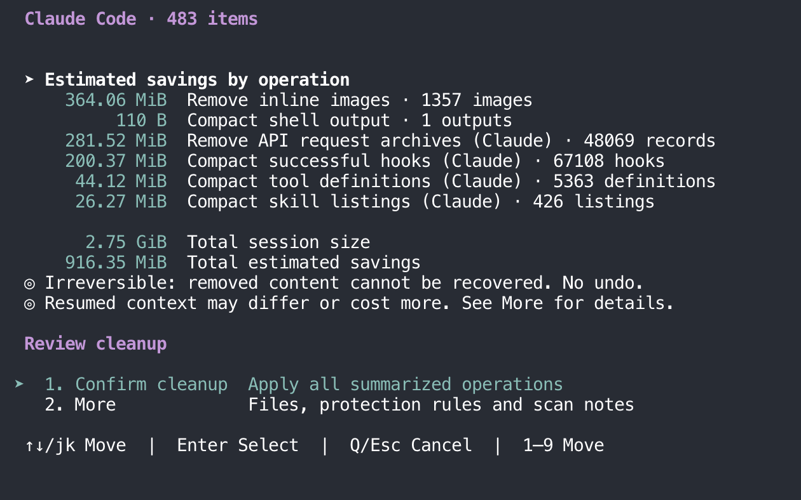
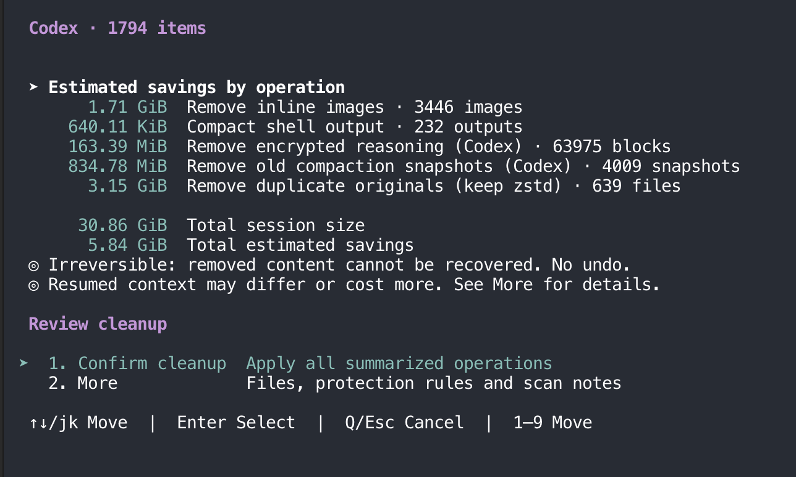

# cc-clean

Free up disk space used by Claude Code and Codex.

```sh
npx cc-clean@latest
```

Requires **Node.js 24+**. Cleanup currently supports **macOS**; other platforms support analysis only.

Choose **Clean → Quick clean**, review the estimated savings, then press **Enter** to confirm.

| Claude Code | Codex |
| :---: | :---: |
|  |  |

Real Quick clean previews; your savings depend on your own history.

## What gets cleaned

- **Temporary files** — old task outputs, logs, working-directory records and leftover installers in recognized locations.
- **Conversation history** — remove embedded images and shorten supported shell outputs while keeping chat text and recorded token/cost usage.
- **Claude Code extras** — remove API request archives and compact successful hooks, saved tool definitions and skill listings.
- **Codex extras** — slim plain or zstd history up to 512 MiB stored and decoded, including encrypted reasoning and older compaction snapshots; remove duplicate history originals when an identical compressed copy exists.
- **Generated PNGs** — losslessly compress supported Codex images.

Use **Clean temporary files** or **Slim history** to choose a narrower cleanup. **Analyze** shows storage and usage; **Statistics** shows past cleanup savings.

## Before you clean

Quick clean only makes irreversible changes to files last modified **more than 72 hours ago**. Open sessions and files that cannot be safely verified are skipped.

Removed content cannot be recovered. History slimming can change the context available when resuming a conversation. Review the [compatibility limits](docs/native-compatibility.md) if you rely on restoring older sessions.

See the [full guide](docs/usage.md) for CLI options, agent/JSON usage, configuration and development.

---

Licensed under [MIT](LICENSE), except for third-party code covered by its own license.

Menu navigation is inspired by [Mole](https://github.com/tw93/mole). Shell-output compaction uses modified TypeScript ports of selected [RTK CLI](https://github.com/rtk-ai/rtk) filters (© 2026 RTK AI Labs), licensed under [Apache-2.0](third_party/rtk/LICENSE). See [ported functions and source details](third_party/rtk/UPSTREAM.md).
